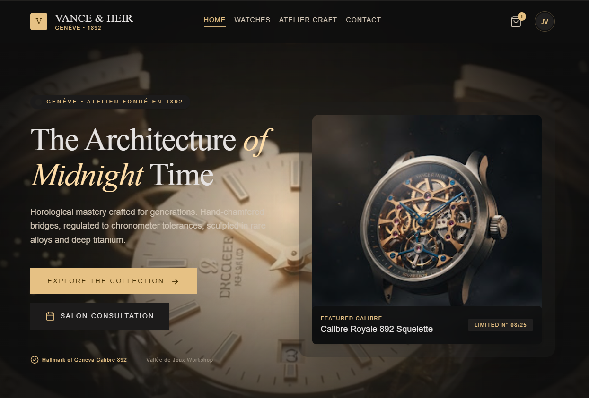
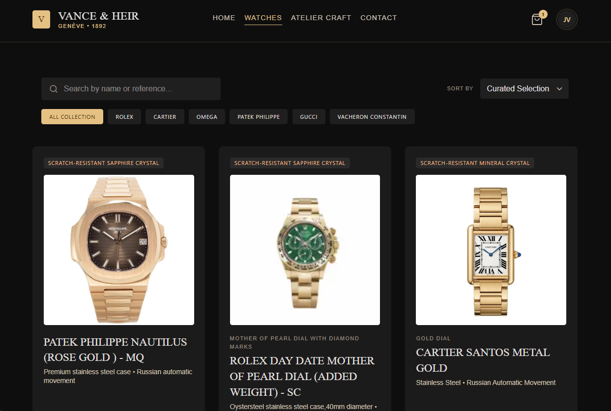

# Vance & Heir — The Watch Store

A modern luxury watch e-commerce application built with **React**, **TypeScript**, **Firebase**, **TanStack Query**, and **Tailwind CSS**.

Browse a curated catalog of high-end timepieces, view detailed specs for each watch, manage a shopping cart, and sign in with a full Firebase authentication flow — all wrapped in a dark, editorial "Swiss watchmaker" aesthetic.

## Screenshots

| Homepage | Watch Details |
|---|---|
|  |  |

> Drop your own screenshots into a `screenshots/` folder at the project root and update the filenames above to match.

## Live Demo

**[watch-store-405de.web.app](https://watch-store-405de.web.app)** — deployed on Firebase Hosting.

## Features

- **Curated collections** — a "Signature Lineages" showcase on the homepage, pulling live data from Firestore
- **Watch catalog** — browsable grid with filtering and pagination
- **Watch details page** — full specs (movement, case material, crystal, dial, price) per piece
- **Authentication** — email/password sign-up & login, Google sign-in, protected/public-only routes, powered by Firebase Auth
- **Shopping cart** — add/remove/update quantities, persisted to `localStorage`, managed with Redux Toolkit
- **Profile page** — view account info, edit display name, view cart, sign out
- **Responsive navigation** — sticky navbar with a mobile menu
- **Scroll-triggered animations** — GSAP + ScrollTrigger entrance animations on the homepage

## Tech Stack

| Layer            | Tech                                           |
| ----------------- | ----------------------------------------------- |
| Framework         | React + TypeScript (Vite)                      |
| Styling           | Tailwind CSS                                   |
| Icons             | lucide-react                                   |
| Routing           | React Router                                   |
| Server state      | TanStack Query (React Query)                   |
| Client state      | Redux Toolkit                                  |
| Backend / Auth    | Firebase (Auth, Firestore, Storage)            |
| Forms/validation  | React Hook Form + Zod                          |
| Animation         | GSAP + ScrollTrigger                           |

## Getting Started

### Prerequisites

- Node.js 18+
- A Firebase project (Auth, Firestore, and Storage enabled)

### Installation

```bash
git clone https://github.com/Kerolos20E/Watch-Store.git
cd Watch-Store
npm install
```

### Environment Variables

Create a `.env` file in the project root with your Firebase config:

```env
VITE_FIREBASE_API_KEY=
VITE_FIREBASE_AUTH_DOMAIN=
VITE_FIREBASE_PROJECT_ID=
VITE_FIREBASE_STORAGE_BUCKET=
VITE_FIREBASE_MESSAGING_SENDER_ID=
VITE_FIREBASE_APP_ID=
```

> Grab these values from your Firebase project settings → General → Your apps → SDK setup and configuration.

### Run locally

```bash
npm run dev
```

The app will be available at `http://localhost:5173` (or whichever port Vite assigns).

### Build for production

```bash
npm run build
npm run preview   # preview the production build locally
```

## Project Structure

```
src/
├── components/      # Reusable UI components (Navbar, WatchCard, CartItem, etc.)
├── pages/           # Route-level pages (Home, WatchesPage, Login, Signup, Profile, Cart)
├── lib/             # Firebase config + Firestore data access (watches, auth helpers)
├── store/           # Redux Toolkit store, slices (auth, cart) and typed hooks
├── hooks/           # Custom hooks (e.g. useScrollReveal)
└── types/           # Shared TypeScript types (Watch, etc.)
```

## Deployment

This project is deployed on **Firebase Hosting** (free Spark plan — more than enough for this app), but can also be deployed on any static host like **Vercel** or **Netlify**. Make sure to set the same environment variables listed above on whichever platform you deploy to.

To redeploy after making changes:

```bash
npm run build
firebase deploy --only hosting
```

## Author

Built by [Kerolos20E](https://github.com/Kerolos20E).

---

This is a personal/educational project — no license applied.
